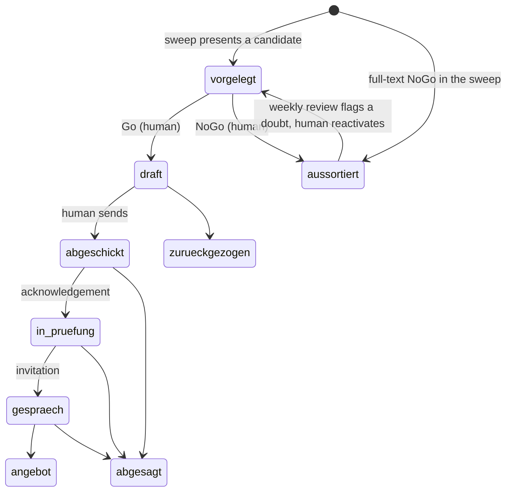

# Architecture

How the system is put together, for readers who want more than the [README](README.md). Code, rules and data
are in German; this page explains them in English.

## Building blocks

| Block | Scripts | Responsibility |
|---|---|---|
| **Single source of truth** | [`pipeline_tx.py`](scripts/pipeline_tx.py), [`status.py`](scripts/status.py), [`ereignis.py`](scripts/ereignis.py), [`jobcoach.py`](scripts/jobcoach.py) | One record per case in `data/pipeline.json`; status change and event log in one step; generated views; consistency watchers |
| **Concurrency** | [`pipeline_tx.py`](scripts/pipeline_tx.py), [`screening_log_tx.py`](scripts/screening_log_tx.py) | Lock file, modification-time check, atomic write |
| **Screening** | [`screening_log.py`](scripts/screening_log.py), [`screening_sweep.py`](scripts/screening_sweep.py), [`publiziert.py`](scripts/publiziert.py), [`dublettencheck.py`](scripts/dublettencheck.py), [`sync_screening_candidates.py`](scripts/sync_screening_candidates.py) | Sweeps against a target catalogue, delta-only sighting log, posting age at discovery |
| **Pre-scan** | [`vorscan.py`](scripts/vorscan.py), [`vorscan_regeln.py`](scripts/vorscan_regeln.py) | Deterministic noise rules for the job board, validated against the full history |
| **Human decision** | [`cockpit.py`](scripts/cockpit.py), [`vorgelegt.py`](scripts/vorgelegt.py), [`offene_auftraege.py`](scripts/offene_auftraege.py) | Everything waiting for the human, in one place, until the record says it is decided |
| **Quality of judgement** | [`review_aussortierte.py`](scripts/review_aussortierte.py), [`analyse_fit_v2.py`](scripts/analyse_fit_v2.py) | Weekly second look at judgement-based drops; rubric tested against outcomes |
| **Pre-send gate** | [`anschreiben_pdf.py`](scripts/anschreiben_pdf.py), [`check_anschreiben.py`](scripts/check_anschreiben.py), [`check_anschreiben_format.py`](scripts/check_anschreiben_format.py) | Cover letter printed from a hash-pinned template by a real browser, checked before sending |
| **Research, letters, interviews** | rules in [`spec/`](spec/) (RECHERCHE, PERSONEN, ANSCHREIBEN, EINGANG, INTERVIEW, CASE), checks in [`status.py`](scripts/status.py), [`offene_auftraege.py`](scripts/offene_auftraege.py), [`check_anschreiben.py`](scripts/check_anschreiben.py) | Model work under written rules: company and people research after every Go, the letter drafted from it, inbound mails filed with an event, interview and case preparation, debriefs. The scripts make the obligations checkable: no sending without research, no letter without provenance |
| **Market observation** | [`marktcheck.py`](scripts/marktcheck.py), [`spec/MARKT.md`](spec/MARKT.md), [`spec/ki_kodierschema.json`](spec/ki_kodierschema.json) | AI skills demanded per month by a fixed coding scheme, who got the roles (pseudonymised, aggregated, small groups suppressed), the gap against the persona's evidence ([`persona/belege.json`](persona/belege.json)) |
| **Learning loop** | [`marktreport.py`](scripts/marktreport.py), [`marktbild.py`](scripts/marktbild.py), [`kanal_auswertung.py`](scripts/kanal_auswertung.py), [`prozess_retro.py`](scripts/prozess_retro.py), [`umbau_kontrolle.py`](scripts/umbau_kontrolle.py) | Funnel, drop reasons, channel yield and speed, process quality, effect of changes |

Standard library only. Every script runs from the repository root and finds its data relative to its own path.
Time comes from [`heute.py`](scripts/heute.py), so the demo and the tests run on a frozen clock.

## Case lifecycle

Status lives only in the record. Every transition goes through `status.py`, which also writes the matching event
(`go`, `nogo`, `versand`, `absage`, …) into the case's `verlauf` with date and source file, and moves the case
folder: `eingang/<id>/` while the case is open (presented or Go), `stellen/<id>/` afterwards. Sending without the
company and people research is refused.

## Sweep model

- **Catalogue as target.** `data/screening_kanaele.json` lists every query (job board searches, network searches,
  company career pages, public-sector portals). A sweep is *complete* only when every active query has a status.
- **Statuses with rules.** `ok` (whole list read), `leer`, `teilweise` (counts only with a technical reason),
  `nicht-erreichbar` (needs a note with route and error), `uebersprungen` (never counts).
- **Method memory.** For each query the log remembers how the list was last read completely; an `ok` with far fewer
  sightings than usual is rejected unless the note proves the list was shorter.
- **Sessions.** A sweep may span several sessions. A session without an end that is younger than an hour blocks a
  parallel start; an aborted sweep's missing queries are carried into the next sweep of the day.
- **Audit.** Each sweep leaves a record in `data/lauf_audit.json`: target, actual, coverage, duration, new
  sightings, candidates. The weekly retro works from these records.

## Concurrency

Several scheduled sessions and an interactive chat can touch the same files. Two rules keep that safe:

1. **One write path per file** (`pipeline_tx.transaktion()`, `screening_log_tx.transaktion()`): exclusive lock file,
   abort on a fresh lock instead of waiting, take over a stale lock with a warning, compare the modification time
   before writing, write atomically via a temp file.
2. **Abort, never merge silently.** A conflict is reported; the session re-reads and repeats its change.

## Demo data

[`init_demo.py`](scripts/init_demo.py) builds the synthetic world from a fixed seed: invented companies (checked
against the Swiss commercial register so that none exists), a query catalogue, eight weeks of sweeps with
realistic failure modes (aborted sessions, unreachable pages, partial lists), and the resulting cases with full
event histories. It writes only raw data, the way the routines would. Everything derived (audits, views,
reports, retro) is computed by the real scripts in [`demo.sh`](scripts/demo.sh). CI regenerates both and fails
if anything differs from what is committed.

## Privacy boundary

This repository is produced from a private working repository by a whitelist sync. Only listed paths are copied;
any new file that is neither whitelisted nor marked private stops the sync. Before publishing, a leak verifier
scans every file for:

- a static list of terms that have no place here,
- a dynamic list built at runtime from the private data (company names, contacts, case folder names) and never
  written to disk,
- e-mail addresses, phone numbers, Swiss social security and IBAN patterns, and URLs outside an allow-list,
- and finally gitleaks.

It runs twice: on the copied sources, and again after the demo and the tests have regenerated everything.
Each publication is a single fresh commit without history.
