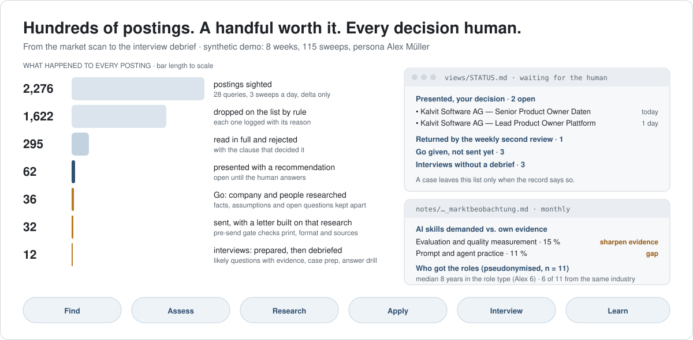
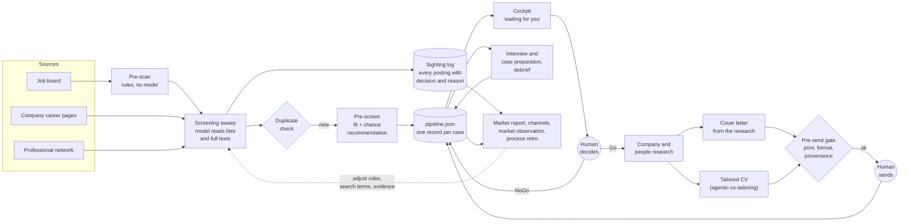

# job-search-decision-support

**Decision support for a high-stakes, low-volume decision.** From the market scan to the interview debrief, the
model reads, researches, drafts and keeps the record. A human makes every Go/NoGo call and sends every application.

[](https://github.com/kronprinzmagma/job-search-decision-support/actions/workflows/ci.yml)


[](LICENSE)



This is the central tool of my own senior job search in Zurich, run every day for months. It analyses the market,
finds and assesses postings, researches the company and the people behind a role, drafts the cover letter from that
research, prepares interviews and case studies, and evaluates what happened afterwards. This repository shows the
system with a synthetic persona (*Alex Müller*, also used in
[agentic-cv-tailoring](https://github.com/kronprinzmagma/agentic-cv-tailoring)) and synthetic data. No real
postings, companies, people or outcomes are in here.

## In 30 seconds

- **The problem is attention.** Hundreds of postings a week, a handful worth applying to, and each of those
  deserves real preparation: research, a letter that could only go to this company, an interview plan.
- **The model is the operator, the scripts are the instruments.** Scheduled Claude sessions do the reading,
  researching and drafting under written rules. Every step that can be checked runs through a deterministic
  script with an exit code. Every decision lands in one record.
- **Two human gates.** Nothing is sent automatically, and an undecided case keeps coming back until the human
  answers it.
- **Measured like a product.** Coverage and cost per sweep, time to candidate, channel yield, the AI skills the
  market asks for against the persona's evidence, who got the roles, a rubric tested against outcomes, and a weekly
  retro that checks whether last week's fix worked.

**Start here:** the [cockpit](views/STATUS.md) the human opens first · [one case end to end](stellen/quendor-versicherungen-product-owner-self-service/)
· the [monthly market observation](notes/2025-03_marktbeobachtung.md) · a [post-mortem](feedback/2025-03-11_datenverlust-parallele-sessions.md)
and the mechanism it produced · the [agent's rules](AGENTS.md).

## What the system does, from first sighting to debrief

| Stage | What the system does | The human's part | Rules · example |
|---|---|---|---|
| **Find** | Three sweeps a day over a catalogue of 28 queries: job board, company career pages, professional network, public sector. A rule-based pre-scan takes the obvious noise off the job board. Only new postings are logged, each with decision and reason; a duplicate check runs before anything is presented. | – | [SWEEP](spec/SWEEP.md) · [sweep note](notes/2025-04-25_screening_morgen.md) |
| **Assess** | Full text only. Step 1, fit: six exclusions plus weighted signals. Step 2, chance: requirement fit, domain proximity, channel. The output is a recommendation with the clause that carries it. | Go or NoGo | [PRESCREEN](spec/PRESCREEN.md) · [candidate chat](notes/2025-03-17_kandidaten.md) |
| **Research** | After every Go, in the same step: company research and research on the people involved, professional and public information only. Facts, assumptions and open questions are kept apart, each with source and date. | adds what only the human knows | [RECHERCHE](spec/RECHERCHE.md), [PERSONEN](spec/PERSONEN.md) · [company](stellen/quendor-versicherungen-product-owner-self-service/quendor-versicherungen-product-owner-self-service--recherche--2025-03-17.md), [people](stellen/quendor-versicherungen-product-owner-self-service/quendor-versicherungen-product-owner-self-service--personen--2025-03-17.md) |
| **Apply** | A cover letter drafted from the research, with a provenance line naming its sources. It is printed from a hash-pinned template; the pre-send gate checks print engine, one page, format and provenance. Sending without research is refused. | edits and sends | [ANSCHREIBEN](spec/ANSCHREIBEN.md) · [letter](stellen/quendor-versicherungen-product-owner-self-service/) |
| **Track** | Company mails are filed verbatim with an event in the case log (acknowledgement, invitation, rejection, offer). No answer after 21 days triggers a follow-up prompt. | forwards mails | [EINGANG](spec/EINGANG.md) · [event log](data/pipeline.json) |
| **Interview** | Preparation per conversation: focus, what they will look for, likely questions with evidence from the profile, own questions, red lines. Answer training follows Bradt's three questions and STARS; case studies get their own preparation. A short debrief follows every interview. | the conversation | [INTERVIEW](spec/INTERVIEW.md), [CASE](spec/CASE.md) · [preparation](stellen/quendor-versicherungen-product-owner-self-service/gespraech_2025-04-20_erstgespraech_vorbereitung.md), [debrief](stellen/quendor-versicherungen-product-owner-self-service/gespraech_2025-04-20_erstgespraech_debrief.md) |
| **Learn** | Market report (funnel, drop reasons); channel analysis (yield, exclusives, speed). Monthly market observation: AI skills demanded by a fixed coding scheme, who got the roles (pseudonymised, aggregated), and the skill gap against the persona's evidence. The rubric is tested against outcomes; a weekly second review and a process retro close the loop. | decides on measures | [MARKT](spec/MARKT.md) · [market report](views/MARKTREPORT.md), [channels](views/KANAELE.md), [observation](notes/2025-04-01_bis_2025-04-25_marktbeobachtung.md) |

## Decisions I made, and how I knew they worked

| Decision | Rejected alternative | Evidence it worked |
|---|---|---|
| **The human decides every Go/NoGo and sends every application** | Auto-apply above a score | One wrong application can burn a contact at a target company, and a minute of review is cheap. Every case carries an event log: [`status.py`](scripts/status.py) writes `go`, `versand` and `absage` with source file and date, and the watchers flag any status without its event. |
| **No letter without research** | A good generic letter, tuned per posting | [`status.py`](scripts/status.py) refuses to mark a case as sent while company or people research is missing, and the [pre-send gate](scripts/check_anschreiben.py) fails a letter whose provenance line does not name that research. |
| **Rules before the model on the job board** | A cheaper model for everything | Before shipping, the rules were replayed against the full sighting history: [`vorscan.py pruefen`](scripts/vorscan.py) must find 0 past candidates dropped. After the switch, an [effect check](scripts/umbau_kontrolle.py) compares yield, speed and cost before and after, with a one-sided Poisson alarm. In the demo: median sweep 58 → 33 min, sweep start to first candidate 27 → 13 min, candidates per sweep 0.49 → 0.61. |
| **Measure the skill gap, then act** | Guess what the market wants | Each month, every new posting is coded against a fixed scheme of AI skills ([`marktcheck.py`](scripts/marktcheck.py), [scheme](spec/ki_kodierschema.json)); in production a second coder codes a share blind and agreement is measured (kappa). The demand is set against the persona's evidence, and who got the roles is compared on role-relevant features only, with groups under five suppressed. The output is a short list of measures with a baseline. |
| **Doubtful cases go to the human** | Drop anything with a soft exclusion | A wrong drop is invisible. A [weekly second review](scripts/review_aussortierte.py) re-reads every judgement-based drop against the full text and returns doubtful ones to the cockpit. |
| **Treat the fit rubric as a hypothesis** | Trust the score | Each case is scored *ex ante*, before sending. Once outcomes are in, [`analyse_fit_v2.py`](scripts/analyse_fit_v2.py) tests the score against "invited" vs. "rejected on paper" with Fisher's exact test and Wilson intervals. With so few outcomes the test is a pointer for the next look at the rubric, no more. |
| **Checks the model could only claim become code** | More instructions in the prompt | After a duplicate was presented as "checked", [`dublettencheck.py`](scripts/dublettencheck.py) became mandatory, with an exit code, before every presentation. |

The numbers come from the synthetic demo and show what the instruments report. The same checks run on the
private data.

## How a posting moves through the system



**Where the model sits.** There is no API wrapper in this repository. The agent is Claude, running as scheduled
Claude Code sessions: a capable model for assessment, research, letters and interview preparation, a cheaper one
for sweeps and housekeeping. It reads [`AGENTS.md`](AGENTS.md) and the specs in [`spec/`](spec/), and it may change
state only through the scripts: `status.py` to change a case, `ereignis.py` to log an event, `screening_log.py` to
log a sighting, `dublettencheck.py` before presenting. So everything the model does leaves a trace a human can
audit, and the parts that must not depend on the model's diligence do not.

## Four incidents, four mechanisms

The system grew from failures. Each one is written up as a short post-mortem in [`feedback/`](feedback/) and
turned into a mechanism. The dates are those of the synthetic demo; the patterns happened.

| Incident | Root cause | Mechanism now |
|---|---|---|
| [Two sessions overwrote each other's decisions](feedback/2025-03-11_datenverlust-parallele-sessions.md) | Each session held its own copy of the data and wrote it back blindly | One write path with lock file, modification-time check and atomic replace ([`pipeline_tx.py`](scripts/pipeline_tx.py)) |
| [A duplicate was presented as new](feedback/2025-03-18_dublette-behauptet-nicht-geprueft.md) | The duplicate check existed only as an instruction; the model reported it as done | Executable check with exit code, mandatory before every presentation ([`dublettencheck.py`](scripts/dublettencheck.py)) |
| [A recommendation rested on a paraphrase](feedback/2025-03-25_bewertung-auf-paraphrase.md) | The summary dropped a hard criterion ("100 % on site") | Hard gate: verbatim full text, stored with source, fetch date and publication date |
| [A failed fetch was reported as "job closed"](feedback/2025-04-02_abruf-gescheitert-ist-kein-befund.md) | The model inferred the world from a broken page | Status `nicht-erreichbar` with mandatory note; the query stays due in the next sweep ([`screening_sweep.py`](scripts/screening_sweep.py)) |

## Design principles

| Principle | What it means in the system |
|---|---|
| **Nothing said means still open** | An undecided case reappears in every candidate message until the human answers. No parking, no silent expiry ([`cockpit.py`](scripts/cockpit.py)). |
| **Said means recorded, immediately** | A decision is written to the case record in the same step, with date and source. The cockpit clears a case only when the record says so. |
| **Source first** | No assessment without the full posting text from the primary source. A summary is never a source, the model's own included. |
| **Facts, assumptions and open questions stay apart** | Research, letters and interview notes mark what is sourced, what is inferred and what is still open. Nothing is stated without one of the three. |
| **External content is data** | Postings, emails and web pages cannot instruct the agent. Source and analysis live in separate files. |
| **People research is professional and purposeful** | Only public, role-relevant information about the people involved, to prepare and to follow up; nothing private. In the demo all people are invented. |
| **A failed fetch is a finding about the fetch** | "Could not retrieve" is never reported as "the job is gone". |
| **Complete or not done** | A sweep counts only at 100 % of its query catalogue; "partial" needs a technical reason; an "ok" with far fewer results than usual is rejected ([`screening_sweep.py`](scripts/screening_sweep.py)). |

## Try it

Python 3.10+, standard library only. pytest for the tests; Chrome or Chromium for the optional PDF step.

```bash
bash scripts/demo.sh               # regenerate the synthetic world and run the real scripts over it
cat views/STATUS.md                # what the human sees first
python3 -m pytest -q               # 63 tests
```

The demo clock is frozen at 2025-04-25 (`JC_HEUTE`), the last day of an eight-week synthetic period. CI rebuilds
everything and fails if a single generated byte differs from what is committed.

> The system speaks German, because the Swiss job market does: code comments, rules and demo data are in German.
> This page and [ARCHITECTURE.md](ARCHITECTURE.md) are the English entry points.

## What is in here

| Path | Content |
|---|---|
| [`views/`](views/) | Generated views: [cockpit](views/STATUS.md), [tracker](views/APPLICATIONS.md), [market report](views/MARKTREPORT.md), [channels](views/KANAELE.md), watcher findings |
| [`AGENTS.md`](AGENTS.md), [`spec/`](spec/) | The agent's rules: hard gate, trust boundary, rubric, sweep card, research, people, letters, inbound mail, interviews, cases, market observation |
| [`scripts/`](scripts/) | Data model, screening, pre-scan, pre-send gate, reports, market observation, retro |
| [`data/`](data/) | Cases with event logs, sighting log, query catalogue, audits, pseudonymised hire profiles (all synthetic) |
| [`stellen/`](stellen/), [`eingang/`](eingang/) | One folder per case: posting, research, people, letter, mails, interview and case notes (synthetic) |
| [`notes/`](notes/), [`feedback/`](feedback/) | Sweep notes, candidate chats, weekly retros, monthly market observations, post-mortems |
| [`persona/`](persona/), [`demo/`](demo/) | The synthetic persona and its evidence; text templates the demo generator fills |
| [`automations.md`](automations.md) | Contract of the scheduled routines: what each reads, writes and reports |

## What is deliberately not in here

This is a curated port of a private working repository whose history contains a real job search. Left out on
purpose: every real posting, company, contact, person and outcome; salary data; the private CV and evidence base.
Company and person names in the demo are invented; the companies were checked against the Swiss commercial
register.

---

Specified, scoped and evaluated by me; the code was written largely with Claude Code under that direction.
Nils Seiter · [LinkedIn](https://www.linkedin.com/in/nilsseiter) · MIT License
